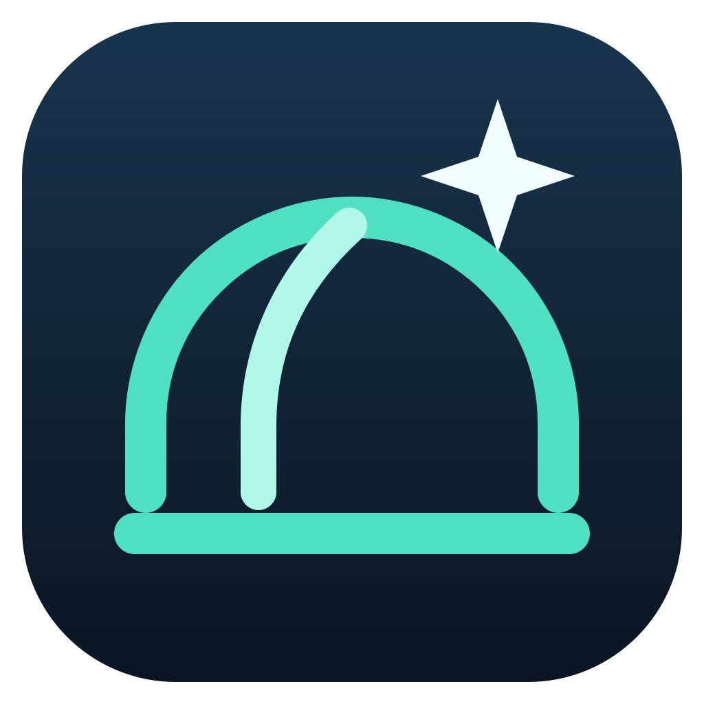

# Seestar Studio — native Windows observatory

Native Windows application for multiple Seestar telescopes, with live images,
telemetry and local observatory tools. **Read-only by default**, with no accounts
or mandatory cloud. This is an independent project, not an official ZWO product.

Native Windows-Anwendung für mehrere Seestar-Teleskope. **READ ONLY als Standard**,
keine Benutzerkonten, keine verpflichtende Cloud. Unabhängiges Projekt, kein
offizielles ZWO-Produkt.

Das [Projekt-Repository](https://github.com/ereterwe/Seestar-Studio) ist öffentlich.
Version **2.3.0b3** wird als lokaler Windows-Kandidat mit Lizenz- und
Paketierungskorrekturen gebaut. Das Quellcode-Update nach GitHub ist beauftragt.
Die bisherige b2-Version bleibt als unveränderte Vergleichsbasis erhalten.
Neue öffentliche Binärdownloads werden erst nach Klärung der dokumentierten
Weitergabepunkte vorbereitet.
Aktueller [Compliance-Bericht](docs/RELEASE_COMPLIANCE_REPORT_2.3.0b3.md) und
[Checkliste](BETA_RELEASE_CHECKLIST.md). Die öffentliche Quellcode-Sichtbarkeit
ist keine automatische Freigabe neuer Projekt-Releases. GPL-Rechte bleiben unberührt.

## Start und Installation

Portable ZIP `release/SeestarStudio-2.3.0b3-win64.zip` vollständig entpacken,
`SeestarStudio.exe` starten. Den gesamten Ordner mit `_internal` erhalten.
Keine separate Python-Installation erforderlich. Alternativ Benutzer-Installer
`release/SeestarStudio-2.3.0b3-setup-win64.exe`. Kein Administrator erforderlich;
Startmenüeintrag, optionale Desktopverknüpfung. Builds sind nicht digital signiert.
Eigene Einstellungen bleiben bei Deinstallation erhalten. [INSTALLATION.md](INSTALLATION.md).

Entwicklung: Python 3.12 x64, `pip install -r requirements-lock.txt`, dann
`python -m seestar_studio`. Startskripte und [BUILDING.md](BUILDING.md) sind enthalten.
Aktuelle Projektversion stammt zentral aus `seestar_studio/__init__.py`.

## Verbindung und Einrichtung

PC und Teleskope müssen im selben erreichbaren lokalen Netzwerk sein.
Geräte werden automatisch erkannt; IPs und Seriennummern sind nicht fest eingebaut.
Vorhandene lokale SeestarPy-Authentifizierung wird weiterverwendet. Fehlt sie,
öffnet sich der Einrichtungsassistent. Eigene berechtigt verwendbare PEM/APK/XAPK
nur lokal auswählen; keine solchen Dateien gehören in ein weitergegebenes Paket.
Details: [docs/LOCAL_SETUP.md](docs/LOCAL_SETUP.md). Kein Seestar-Account nötig.

## Funktionen

- Unabhängige Live-Stack-Ansichten mit RAW/JPEG, Zoom, Verschieben, Maximieren,
  Vollbild, Bildspeicherung und authentifizierter Telemetrie.
- Separater Live View pro Gerät, sofern das Gerät RTSP-Video bereitstellt.
  Ein Quellenwechsel aktiviert keinen Gerätemodus und stoppt keine Aufnahme.
- Dateimanager mit lokalen Downloads, Abbruch/Resume und Bandbreitenlimit.
- Sky Explorer: 14.034 lokale Katalogeinträge, Sichtbarkeitsberechnung nach
  bestätigtem Standort. Optionale Windows- oder lesende Seestar-Standortvorschläge;
  manuelle Eingabe bleibt erhalten. Keine ungefragte Standortbestimmung.
- Astronomischer Tag-Nacht-Hintergrund mit lokalen Sonnenereignissen,
  abschaltbar, auf Basis des bestätigten Standorts; vollständig offline.
- Direkter Windows-Standorteinstellungs-Link bei Zugriffsproblemen; nur per Klick.
- Grafischer Mehrgeräte-Planer: lokale Zeit, DST, freie Slots, Wechselzeiten,
  Drag/Resize, Konflikte und gespeicherte Pläne. Keine automatische Ausführung.
- Session-Analyse, Diagnoseexport, lokaler Setup-Assistent und DE/EN/Windows-Sprache.
- Optionale Steuerung separat gesperrt; jede Aktion benötigt ausdrückliche Freigabe.

## Teststand und Grenzen

2.3.0b2: 154 automatisierte Tests bestanden. Details: [b2-Testbericht](docs/B2_TEST_REPORT.md).

S50 und S50 Pro sind für die dokumentierten Viewer-/Telemetrie-/Downloadfunktionen
hardwaregetestet. S30/S30 Pro sind theoretisch kompatibel; keine reale Testhardware.
Keine pauschale Zusage für alle Firmware-/Modellfunktionen. [COMPATIBILITY.md](COMPATIBILITY.md).
RTSP war während der geprüften Deep-Sky-Aufnahmen nicht verfügbar; echte
Videowiedergabe bleibt unbestätigt. Standortdienste, Fremd-PC-Installation und
Langzeitbetrieb benötigen die in der Beta-Checkliste genannten Abnahmen.

## Probleme melden

Version, Windows-Version, Modell/Firmware, betroffene Funktion und Schritte
notieren. Unter Diagnose eine Vorschau prüfen und ausdrücklich lokal exportieren.
Berichte erst nach eigener Datenschutzprüfung auf dem mit Mark vereinbarten
privaten Weg weitergeben. Keine Schlüssel, APKs, Rohlogs, präzisen Standorte oder
persönlichen Aufnahmen mitsenden. Testanleitung: [docs/BETA_TEST_GUIDE.md](docs/BETA_TEST_GUIDE.md).
Mark sammelt und priorisiert Feedback; keine automatische Übermittlung.

## Quellen und Lizenzen

Projekt GPL-3.0-only, ohne Gewährleistung. Unabhängig von ZWO; keine offizielle
Unterstützung durch ZWO oder OpenAI. Idee/Konzept/Projektleitung: Mark.
Softwareentwicklung: OpenAI Codex, KI-gestützt. Original-Icon: eigene Projektgrafik.
Der Über-Dialog nennt tatsächliche Versionen und vorhandene lokale Dateien.
App-Quellen: `SeestarStudio-source.zip`, zusätzlich separates versionsbezogenes
Quellarchiv. Upstream-Quellen liegen im separaten Drittanbieter-Quellenpaket.
Noch offene Weitergabepflichten: [LICENSING.md](LICENSING.md),
[THIRD_PARTY_NOTICES.md](THIRD_PARTY_NOTICES.md).

Seit Abschluss dieser Beta-Vorbereitung gilt Feature Freeze. Neue Funktionen
und Bearbeitung von Testerfeedback nur nach einem neuen ausdrücklichen Auftrag.

## Beobachtung in 2.3.0b2

Im Sky Explorer ein Ziel wählen, in der Steuerung das Teleskop ausdrücklich
auswählen und Control Mode freigeben. Falls geparkt, zunächst Entparken bestätigen.
**Ziel anfahren & Aufnahme starten** beginnt die bestätigte astronomische Sequenz;
**Nur GoTo** bewegt ausschließlich die Montierung. Bereits aktive Vorschauen oder
Aufnahmen zuerst bewusst beenden. Gesperrte Aktionen erklären ihre Voraussetzungen
im Tooltip. Sternenvorschau, allgemeiner Live View und Live Stack sind getrennte
Zustände. Das Ergebnis der letzten Aktion ersetzt nicht den aktuellen Gerätestatus.

S50/S50 Pro wurden im Innenraum geprüft. Erfolgreiches Plate Solving, Autofokus
unter Sternen und der vollständige Aufnahmeablauf bleiben draußen abzunehmen.
Details und Grenzen: [Steuerungsbericht](docs/CONTROL_B2_REPORT.md).

Private GitHub-Übertragung und Paketumfang: [GITHUB_DELIVERY.md](docs/GITHUB_DELIVERY.md).
